# Banco de dados — Ebenézer Conecta v1.3.0

Documento de referência do desenho do banco de dados: o que é guardado, como as entidades se relacionam, quem pode ver e alterar cada dado, as regras de integridade e como migrar para um banco em nuvem.

> Todos os dados da demonstração são **fictícios**.

## 1. Onde os dados ficam

| Nível | Armazenamento | Quando usar |
|---|---|---|
| **Nível 0 e 1 (hoje)** | Um único objeto JSON (`DB`) no `localStorage` do navegador, chave `ebenezer-conecta-v10`. Criado por `seedDB()` e salvo por `saveDB()` a cada ação, em `index.html`. | Demonstração e piloto em **um aparelho do Instituto**. O dado não sai do aparelho. Backup semanal pelo botão "Exportar backup (JSON)", em Governança. |
| **Nível 2 (produção)** | PostgreSQL gerenciado (Supabase, região São Paulo), com o esquema do arquivo [`schema-supabase.sql`](schema-supabase.sql) e regras de acesso por perfil no próprio banco (Row Level Security). | Todas as turmas, vários aparelhos, login individual. Só depois de a diretoria aprovar onde o dado fica e o termo LGPD. |

O desenho abaixo vale para os dois níveis: as coleções do JSON viram tabelas, com os mesmos nomes de campos.

## 2. Diagrama entidade-relacionamento

O diagrama renderizado está em [`entrega/diagrama-banco-de-dados.svg`](entrega/diagrama-banco-de-dados.svg) e em PDF em [`entrega/banco-de-dados.pdf`](entrega/banco-de-dados.pdf). O código-fonte do diagrama (Mermaid) é este:

```mermaid
erDiagram
    PROGRAMA ||--o{ VINCULO : "tem"
    EDUCANDO ||--o{ VINCULO : "participa de"
    EDUCANDO ||--|| RESPONSAVEL : "tem"
    PROGRAMA ||--o{ ENCONTRO : "realiza"
    ENCONTRO ||--o{ MARCACAO_PRESENCA : "contém"
    EDUCANDO ||--o{ MARCACAO_PRESENCA : "recebe"
    ENCONTRO ||--o| REGISTRO_GRUPO : "pode ter"
    EDUCANDO ||--o{ AVALIACAO : "recebe"
    DIMENSAO ||--|{ FRASE : "agrupa"
    AVALIACAO ||--|{ RESPOSTA : "contém"
    FRASE ||--o{ RESPOSTA : "é respondida em"
    EDUCANDO ||--o{ OBSERVACAO : "é descrito em"
    EDUCANDO ||--o{ INTERVENCAO : "é alvo de"
    AVALIACAO |o--o| ENCAMINHAMENTO : "gera, se atenção"
    EDUCANDO ||--o{ ENCAMINHAMENTO : "é sinalizado em"
    EDUCANDO ||--o| CASO_CLINICO : "pode ter"
    CASO_CLINICO ||--o{ ATIVIDADE_CLINICA : "registra"
    EDUCANDO ||--o{ NOTIFICACAO : "é objeto de"
    NOTIFICACAO ||--o{ ACAO_NOTIFICACAO : "registra"
    USUARIO ||--o{ AUDITORIA : "gera"

    PROGRAMA {
        text id PK "lab, re, pi, vt, cp"
        text nome
        bool presencaOnly "sem avaliação individual"
        text lider "psicologa ou vazio"
    }
    EDUCANDO {
        text id PK "EDU-0001"
        text nome
        int idade
        date nasc
        bool consentimento "termo LGPD do responsável"
        date entrada
    }
    RESPONSAVEL {
        text nome
        text rel "Mãe, Pai, Avó"
        text contato "só psicóloga"
    }
    VINCULO {
        text childId FK
        text turmaId FK
    }
    ENCONTRO {
        text chave PK "turmaId_data"
        text turmaId FK
        date data
        text clima "tranquilo, neutro, agitado"
        bool fechado
    }
    MARCACAO_PRESENCA {
        text chave FK
        text childId FK
        text marca "presente, justificada, falta"
    }
    REGISTRO_GRUPO {
        text chave FK
        text_array atividades "atividade ou tema"
        text engaj "maioria, parte, pouco"
        text_array movimentos "só grupos da psicóloga"
        text obs "coletiva, sem nomes"
        text autor
        timestamp em
    }
    AVALIACAO {
        text id PK
        text childId FK
        text turmaId FK
        date data
        text tipo "inicial, checkin"
        text modo "rapido, completo"
        bool atencaoPsicologa
    }
    RESPOSTA {
        text avaliacaoId FK
        text fraseK FK
        text valor "sim, nao, nao_observei"
    }
    FRASE {
        text k PK
        text t
        text dim FK
        bool quick
        int versao
    }
    OBSERVACAO {
        text id PK
        text childId FK
        text turmaId FK
        date data
        timestamp criadoEm
        text metodo "ditado, escrito"
        text texto
        text status "aguardando, validado, devolvido"
        text motivo
    }
    INTERVENCAO {
        text id PK
        text childId FK
        text acao
        text objetivo
        int estagio "1, 2, 3"
        text resultado
    }
    ENCAMINHAMENTO {
        text id PK
        text childId FK
        date data
        text status "pendente, revisado"
    }
    CASO_CLINICO {
        text id PK
        text childId FK
        text_array tipos
        text objetivo
        text status
    }
    ATIVIDADE_CLINICA {
        text id PK
        date data
        text tipo
        text evolucao
        json encaminhamento
    }
    NOTIFICACAO {
        text id PK
        text childId FK
        text tipo "violencia, risco, atipico, ausencia, saude, outro"
        text urgencia "critica, alta, atencao"
        text descricao
        text status "aberta, em_andamento, encerrada"
        text responsavel
        text desfecho
        timestamp criadoEm
    }
    ACAO_NOTIFICACAO {
        timestamp ts
        text autor
        text tipo
        text texto
    }
    AUDITORIA {
        timestamp ts
        text texto "sem conteúdo sensível"
    }
```

## 3. Dicionário de dados

Sensibilidade: **I** interna (dado do programa, sem pessoa); **P** pessoal (identifica a criança ou o responsável); **S** sensível de criança (LGPD, art. 14); **R** restrita (só psicóloga, ou só coordenação e psicóloga).

### `children` — Educando

| Campo | Tipo | Obrig. | Exemplo | Descrição | Sens. |
|---|---|---|---|---|---|
| `id` | texto | sim | `EDU-0005` | Código único, padrão `EDU-` + 4 dígitos. Chave primária. | P |
| `nome` | texto | sim | Elias Esteves | Nome completo. | P |
| `idade` | inteiro | sim | 10 | Idade no ciclo. | P |
| `nasc` | data | sim | 2016-01-20 | Data de nascimento. | P |
| `resp.nome`, `resp.rel` | texto | sim | Luciana Esteves, Mãe | Responsável legal e parentesco. | P |
| `resp.contato` | texto | sim | (11) 9…-… | Telefone. Exibido só à psicóloga. | R |
| `turmas[]` | lista de texto | sim | `['lab','cp']` | Vínculos com programas (chaves estrangeiras para `TURMAS`). | I |
| `consentimento` | booleano | sim | true | Termo assinado pelo responsável. Sem ele, avaliação e observação ficam bloqueadas e a criança sai dos agregados. | P |
| `entrada` | data | sim | 2026-03-07 | Início no Instituto. | I |
| `freq.p`, `freq.j`, `freq.t` | inteiros | sim | 3, 1, 11 | Presenças, faltas justificadas e encontros no período. | I |

### `TURMAS` — Programa (constante no código)

| Campo | Tipo | Descrição |
|---|---|---|
| `id` | texto | `lab` Laboratório de Sonhos, `re` Reforço Escolar, `pi` Primeira Infância, `vt` Vivência Terapêutica, `cp` Começos que Protegem. |
| `nome` | texto | Nome exibido. |
| `presencaOnly` | booleano | `true` quando o programa não tem avaliação individual (grupos da psicóloga). |
| `lider` | texto | `psicologa` nos grupos conduzidos por ela. O conteúdo do registro do grupo desses programas é visível só a ela. |

### `presencas` — Encontro, presença e registro do grupo

Chave: `turmaId_data` (ex.: `lab_2026-08-29`).

| Campo | Tipo | Descrição | Sens. |
|---|---|---|---|
| `clima` | texto | `tranquilo`, `neutro` ou `agitado`. Opcional. | I |
| `fechado` | booleano | Depois de fechado, só a coordenação reabre a presença. | I |
| `marks{childId}` | texto | `presente`, `justificada` ou `falta`. Falta justificada não pesa no sinal de atenção de 75%. | P |
| `grupo.atividades[]` | lista de texto | Atividades (equipe) ou temas (psicóloga) do encontro. | I |
| `grupo.engaj` | texto | `maioria`, `parte` ou `pouco`. | I |
| `grupo.movimentos[]` | lista de texto | Só nos grupos da psicóloga (ex.: "Escuta entre os participantes"). | R |
| `grupo.obs` | texto | Observação geral, coletiva. O app avisa se citar o nome de uma criança. | I / R |
| `grupo.autor`, `grupo.em` | texto, timestamp | Quem salvou e quando. | I |

### `avaliacoes` — Avaliação socioemocional (Direct Behavior Rating)

| Campo | Tipo | Descrição | Sens. |
|---|---|---|---|
| `id` | texto | Chave primária. | I |
| `childId`, `turmaId` | texto | Chaves estrangeiras. Só existe para criança com consentimento e programa sem `presencaOnly`. | P |
| `data` | data | Data do encontro avaliado. | I |
| `tipo` | texto | `inicial` (a primeira do vínculo) ou `checkin` (as seguintes). Calculado pelo app. | I |
| `modo` | texto | `rapido` (5 frases) ou `completo` (16 frases). | I |
| `autor` | texto | `Equipe`. | I |
| `respostas{fraseK}` | texto | `sim`, `nao` ou `nao_observei`. | S |
| `atencaoPsicologa` | booleano | Se marcado, gera um encaminhamento sem motivo escrito. | S |

### `frases` — Frases-fato do instrumento

16 frases em 5 dimensões (Eu e minhas emoções, Eu e os outros, Eu e a atividade, Eu e o combinado, O que a gente fez). Campos: `k` (chave), `t` (texto), `dim`, `quick` (entra no modo rápido), `versao` e `atualizadoEm`. Editáveis só pela psicóloga; cada edição incrementa a versão. Em "Entrou em conflito" e "Ficou fora do grupo", o comportamento desejado é "não".

### `registros` — Observação descritiva

| Campo | Tipo | Descrição | Sens. |
|---|---|---|---|
| `id`, `childId`, `turmaId`, `data` | texto, data | Identificação. | P |
| `criadoEm` | timestamp | Momento do registro (o app avisa se foi feito dias depois do encontro). | I |
| `autor` | texto | Quem registrou. | I |
| `metodo` | texto | `ditado` (transcrito pelo teclado do celular; nenhum áudio é guardado) ou `escrito`. | I |
| `texto` | texto | O que a criança fez. Não pode citar outra criança, diagnóstico, saúde ou família. | S |
| `status` | texto | `aguardando` → `validado` ou `devolvido`. Só o validado conta no relatório. | I |
| `motivo` | texto | Motivo da devolução, escrito pela coordenação. | I |

### `intervencoes` — Ação pedagógica

`id`, `childId`, `turmaId`, `acao`, `objetivo`, `propostoPor`, `propostoEm`, `estagio` (1 proposta, 2 acompanhamento, 3 validada), `resultado`, `observacao`, `metodo`. Proposta pela coordenação ou pela psicóloga. Sensibilidade: P.

### `encaminhamentos` — Sinalizador para a psicóloga

`id`, `childId`, `turmaId`, `data`, `status` (`pendente` ou `revisado`). Criado automaticamente pela avaliação com "atenção da psicóloga". Não guarda motivo. Visível só à psicóloga. Sensibilidade: R.

### `casos` e `casos[].atividades` — Prontuário psicológico (padrão CRP)

Caso: `id`, `childId`, `tipos[]`, `descricao`, `objetivo`, `status`, `criadoEm`. Atividade: `id`, `data`, `profissional`, `tipo`, `objetivoAtividade`, `procedimentos`, `evolucao`, `demandas` e `encaminhamento` (`paraQuem`, `motivo`, `data`, `responsavel`, `retorno`). Exclusivo da psicóloga. Sensibilidade: R.

### `notificacoes` e `notificacoes[].acoes` — Situação urgente ou fora da curva

| Campo | Tipo | Descrição | Sens. |
|---|---|---|---|
| `id`, `childId` | texto | Identificação. | P |
| `tipo` | texto | `violencia`, `risco`, `atipico`, `ausencia`, `saude` ou `outro`. | R |
| `urgencia` | texto | `critica` (agir hoje, prazo de 24 h), `alta` (48 h) ou `atencao` (7 dias). | R |
| `descricao` | texto | O que foi visto ou ouvido, com as palavras da criança entre aspas. | R |
| `autor`, `criadoEm` | texto, timestamp | Quem notificou e quando. | R |
| `status` | texto | `aberta` → `em_andamento` (ao assumir ou registrar ação) → `encerrada`. | R |
| `responsavel` | texto | Quem assumiu. | R |
| `acoes[]` | lista | `ts`, `autor`, `tipo` (ex.: "Conselho Tutelar comunicado") e `texto`. | R |
| `desfecho`, `encerradoEm` | texto, timestamp | Em `violencia`, só aceita "Conselho Tutelar comunicado" ou "Conselho Tutelar já acompanhava o caso" (ECA, art. 13). | R |

### `auditLog` — Trilha de auditoria

`ts` e `texto`. Toda ação sensível gera uma linha (consentimento, validação, devolução, avaliação, intervenção, caso, notificação, backup). O texto nunca copia o conteúdo de um relato ou de uma observação.

### Outros campos

`ultimoBackup` (timestamp do último backup exportado).

## 4. Relacionamentos e cardinalidade

| De | Para | Cardinalidade | Regra |
|---|---|---|---|
| Educando | Programa | N : N, via `turmas[]` (vínculo) | Uma criança em duas turmas conta uma vez nas contagens de crianças. |
| Programa | Encontro | 1 : N | Chave `turmaId_data`; um encontro por programa por dia. |
| Encontro | Marcação de presença | 1 : N | Uma marcação por criança vinculada. |
| Encontro | Registro do grupo | 1 : 0..1 | Coletivo. Nos grupos da psicóloga, só ela registra. |
| Educando | Avaliação | 1 : N, por programa | A primeira de cada vínculo é `inicial`. |
| Avaliação | Encaminhamento | 1 : 0..1 | Só se `atencaoPsicologa`. |
| Educando | Observação, Intervenção, Notificação | 1 : N | — |
| Educando | Caso clínico | 1 : 0..1 | — |
| Caso clínico | Atividade clínica | 1 : N | — |
| Notificação | Ação | 1 : N | — |

## 5. Regras de integridade e de negócio

1. **Consentimento:** sem `consentimento`, o app bloqueia avaliação e a criança sai de todos os agregados. A notificação urgente **não** depende de consentimento, porque proteger a criança vem antes.
2. **Revisão humana:** observação nasce `aguardando` e só conta no relatório depois de `validado`. Devolução exige motivo.
3. **Presença fechada:** só a coordenação reabre. O registro do grupo continua editável.
4. **Sem nomes no coletivo:** o registro do grupo e os relatórios são agregados; o app avisa quando um texto coletivo cita uma criança.
5. **Base mínima:** a leitura de evolução de um programa só aparece com 5 crianças ou mais com duas avaliações (evita identificar alguém e tirar conclusão de base pequena).
6. **Proteção:** suspeita de violência só se encerra com o Conselho Tutelar comunicado. Notificações nunca aparecem em relatórios.
7. **Auditoria:** toda escrita sensível gera uma linha na trilha, sem copiar conteúdo.

## 6. Quem vê e quem altera (matriz de acesso)

L = lê · C = cria · A = altera · — = sem acesso

| Coleção | Equipe | Coordenação | Psicóloga |
|---|---|---|---|
| Educandos (sem contato do responsável) | L | L, A (consentimento) | L |
| Contato do responsável | — | — | L |
| Presença e clima | L, C, A (até fechar) | L, C, A (reabre) | L, C, A |
| Registro do grupo · programas da equipe | L, C, A | L, C, A | L |
| Registro do grupo · grupos da psicóloga | só "foi registrado" | só "foi registrado" | L, C, A |
| Avaliações | L, C | L, C | L, C |
| Observações | L, C, A (15 min) | L, C, A (valida ou devolve) | L, C |
| Intervenções | L | L, C, A | L, C |
| Encaminhamentos | — | — | L, A |
| Caso clínico | — | — | L, C, A |
| Notificações | C (não vê a lista) | L, C, A | L, C, A |
| Frases do instrumento | L | L | L, A |
| Relatórios | — | L (agregado) | — |
| Auditoria e backup | — | L, exporta, restaura | — |

No nível 2, esta matriz vira políticas de Row Level Security (ver `schema-supabase.sql`).

## 7. LGPD, retenção e descarte

| Dado | Base | Retenção sugerida | Descarte |
|---|---|---|---|
| Cadastro, presença, avaliações e observações | Consentimento específico e em destaque de um dos pais (LGPD, art. 14, §1º) | Enquanto a criança estiver no Instituto + 2 anos, para a série histórica | Anonimizar (remover nome, nascimento e responsável) e manter só os agregados |
| Caso clínico | Obrigação profissional da psicóloga (normas do CRP) | Prazo definido pelo Conselho Federal de Psicologia para prontuário | Sob guarda da psicóloga |
| Notificações | Proteção integral da criança (ECA) | Igual ao caso clínico | Sob guarda da coordenação e da psicóloga |
| Áudio do ditado | — | Não é guardado | — |

Os prazos devem ser validados pela diretoria com orientação jurídica antes de usar dados reais.

## 8. Consultas mais usadas (índices no nível 2)

| Consulta | Onde aparece | Índice sugerido |
|---|---|---|
| Observações `aguardando` | Fila de revisão da coordenação | `registros (status, data)` |
| Avaliações por criança e programa, em ordem de data | Trajetória e evolução | `avaliacoes (child_id, turma_id, data)` |
| Notificações abertas por urgência | Painel de urgências | `notificacoes (status, urgencia, criado_em)` |
| Encontros por programa | Presença e relatório | `encontros (turma_id, data)` único |

## 9. Versões do esquema

| Chave do `localStorage` | Versão do app | Mudança |
|---|---|---|
| `ebenezer-conecta-v7` | 1.0.x | Esquema inicial |
| `ebenezer-conecta-v8` | 1.1.0 | `presencas[].grupo`; programa Começos que Protegem |
| `ebenezer-conecta-v9` | 1.2.0 | Avaliações de acompanhamento para a base do relatório |
| `ebenezer-conecta-v10` | 1.3.0 | Coleção `notificacoes`; `ultimoBackup` |

Ao mudar a estrutura, aumente a versão em `LS_KEY`. Bases antigas sem uma coleção nova são completadas por `ensureDB()`. Para levar dados entre versões, exporte o backup antes e restaure depois.

## 10. Backup e restauração

- **Exportar:** Governança → "Exportar backup (JSON)". Gera `ebenezer-conecta-backup-AAAA-MM-DD.json` com a versão do app e todo o `DB`. Recomendação: toda semana, guardado no Drive institucional, com acesso só da coordenação.
- **Restaurar:** Governança → "Restaurar a partir de um backup". O app confere a estrutura antes de substituir os dados e registra na auditoria.
- **Atenção:** o arquivo de backup contém dados pessoais de crianças. Não enviar por WhatsApp nem e-mail pessoal.
